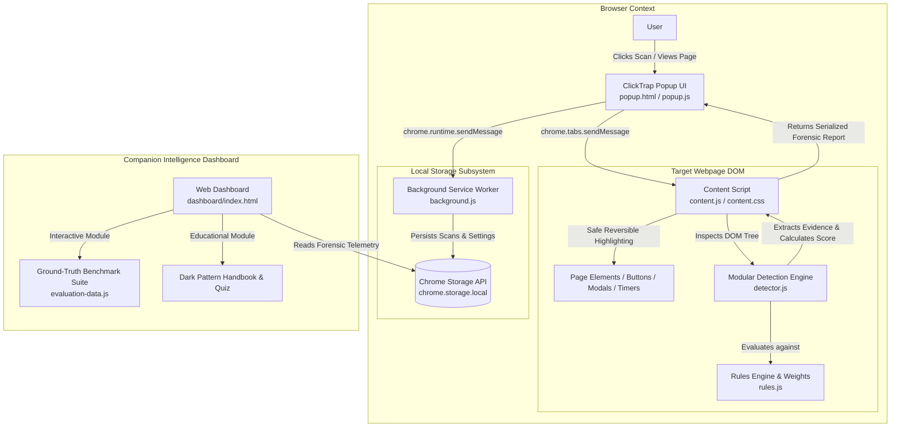

# ClickTrap – System Architecture & Technical Specification

ClickTrap is a local-first cybersecurity browser extension and companion intelligence dashboard engineered to detect and analyze deceptive user-interface designs (dark patterns) across modern websites.

---

## 1. High-Level Architecture Diagram



---

## 2. Core Architectural Components

### A. Modular Detection Engine (`detector.js`)
- **Zero-Dependency Architecture:** Operates seamlessly across browser content scripts and headless Node.js testing environments without third-party frameworks.
- **Pattern Matching Pipeline:** Regex-based linguistic scanners targeting exclamatory pressure, guilt-inducing opt-outs, artificial deadlines, and drip pricing disclosures.
- **DOM Heuristics Engine:**
  - `detectCountdownElement`: Evaluates active time-series formats (`\d{1,2}:\d{2}`) combined with countdown DOM attributes and CSS classes.
  - `detectAsymmetricConsent`: Analyzes visual hierarchy and element types in cookie consent dialogs (e.g., prominent button vs muted text link).
  - `detectMissingRejectOption`: Identifies banners lacking direct one-click rejection mechanisms.
  - `detectPrecheckedConsent`: Inspects checkboxes in consent dialogs with default-checked states targeting non-essential marketing or analytics.
  - `detectPrecheckedAddons`: Scans checkout cart containers for pre-selected paid protection, warranties, or donations.

### B. Rule-Based Scoring Engine (`rules.js`)
Each rule adheres to a formal schema:
```javascript
{
  id: "FU_COUNTDOWN_TMR",
  category: "fake_urgency",
  name: "Active Countdown Timer Element",
  weight: 20,
  severity: "high",
  type: "heuristic",
  explanation: "A visual countdown timer was detected...",
  recommendedAction: "Do not rush your decision..."
}
```
- **Diminishing Returns Normalization:** Raw points are scaled using a bounded saturation curve:
  $$\text{Score} = \min\left(100, \text{round}\left(100 \times \left(1 - e^{-\frac{\text{rawScore}}{42}}\right)\right)\right)$$
- **Score Tiers:**
  - `0 – 24`: Low Suspicion (Ethical or benign baseline)
  - `25 – 49`: Moderate Suspicion (Presence of minor urgency or soft scarcity)
  - `50 – 74`: High Suspicion (Pre-selected add-ons or asymmetric consent)
  - `75 – 100`: Very High Suspicion (Active countdown timers with high-pressure drip pricing)

### C. Content Script & Safe Highlighting (`content.js` & `content.css`)
- **Non-Destructive DOM Injection:** Applies outline styles and floating category badges using `.clicktrap-highlighted` and `.clicktrap-badge`.
- **Complete Reversibility:** Cleans up injected styles, restores original positions, and removes custom badges without modifying the host page DOM nodes.

### D. Service Worker & Storage (`background.js`)
- Manages asynchronous event dispatching.
- Maintains local scan history capped at 100 entries.
- Dynamically updates the Chrome extension action badge with the risk score.

---

## 3. Storage Design Schema

Stored within `chrome.storage.local` (with transparent `localStorage` fallback for the dashboard):

```json
{
  "settings": {
    "highlightingEnabled": true,
    "historyEnabled": true,
    "maxHistoryItems": 100,
    "theme": "dark",
    "lastUpdated": "2026-10-26T17:00:00.000Z"
  },
  "scanHistory": [
    {
      "id": "scan-1729958400000-123",
      "domain": "store.example.com",
      "url": "https://store.example.com/checkout",
      "timestamp": "2026-10-26T17:00:00.000Z",
      "score": 68,
      "rawScore": 48,
      "level": {
        "min": 50,
        "max": 74,
        "label": "High Suspicion",
        "level": "high",
        "badgeClass": "badge-high",
        "color": "#FF922B"
      },
      "findingsCount": 3,
      "summary": "Detected 3 potential dark pattern signals across 2 categories.",
      "categoryDistribution": {
        "fake_urgency": 1,
        "scarcity_manipulation": 0,
        "cookie_consent": 0,
        "hidden_costs": 2,
        "confirmshaming": 0,
        "obstructive_cancellation": 0
      },
      "findings": [
        {
          "id": "ct-1729958400000-456",
          "ruleId": "HC_MANDATORY_FEE",
          "category": "hidden_costs",
          "categoryName": "Hidden or Late-Disclosed Costs",
          "ruleName": "Mandatory Surcharge / Late-Added Fee",
          "severity": "medium",
          "weight": 15,
          "evidence": "Mandatory service fee added at checkout: $14.50",
          "fullContext": "Mandatory service fee added at checkout: $14.50",
          "selector": ".fee-box",
          "explanation": "Compulsory fee disclosed late in checkout.",
          "recommendedAction": "Verify total price before entering payment details."
        }
      ]
    }
  ],
  "userFeedback": [
    {
      "id": "fb-1729958400000",
      "findingId": "ct-1729958400000-456",
      "ruleId": "HC_MANDATORY_FEE",
      "domain": "store.example.com",
      "feedbackType": "helpful",
      "timestamp": "2026-10-26T17:05:00.000Z"
    }
  ]
}
```

---

## 4. Cybersecurity & Privacy Analysis

1. **Strict Local-First Operation:**
   - 0 bytes of scanned page text or user navigation history are sent over the network.
   - Operates fully offline without external API keys or third-party tracking scripts.
2. **Least Privilege Compliance (Manifest V3):**
   - `activeTab`: Grants temporary DOM access to the active webpage only upon explicit user interaction (no background surveillance).
   - `scripting`: Required to inject detection logic safely into existing tabs.
   - `storage`: Required for local preferences and scan audit logs.
3. **Defense Against Unsafe Content:**
   - Page text snippets are strictly treated as plain text strings (`textContent` / sanitized text) and never rendered as raw executable HTML, eliminating Cross-Site Scripting (XSS) vectors.
   - No `eval()`, `new Function()`, or dynamic remote code execution.
