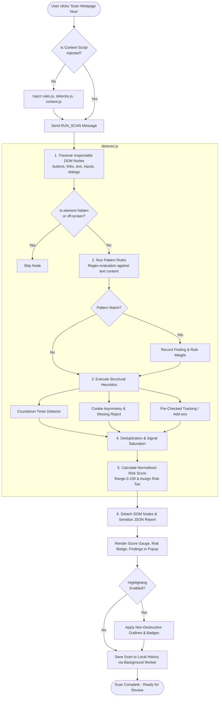
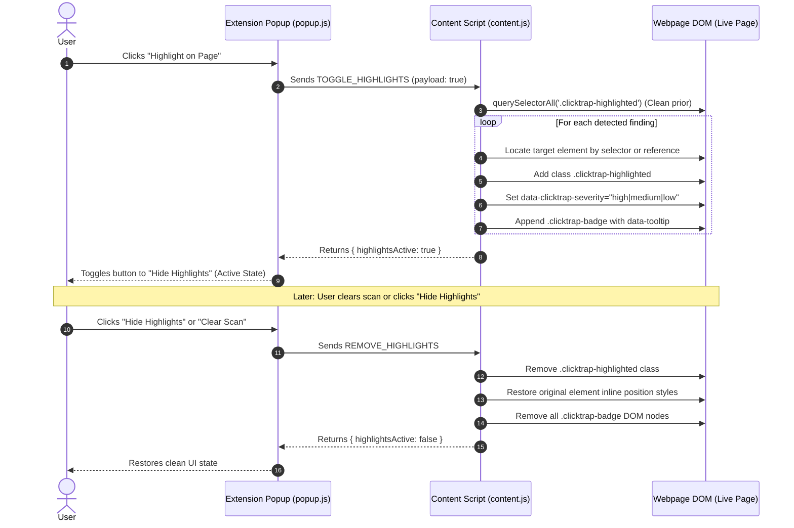

# ClickTrap – Detection Engine Flowchart & Process Pipeline

This document details the multi-stage detection pipeline implemented within `detector.js`, `content.js`, and `rules.js`.

---

## 1. High-Level Detection Flowchart

---

## 2. Evidence Highlighting & Reversibility Subsystem

---

## 3. Detailed Algorithmic Step Description

### Phase 1: DOM Querying and Filtering
1. The engine collects potential interaction points using targeted selectors:
   `button, a, p, span, div, h1..h6, label, strong, [role="button"], [role="alert"], .banner, .modal`.
2. Evaluates visibility via `getBoundingClientRect()` and `getComputedStyle()`. Elements with `display: none`, `visibility: hidden`, or `opacity: 0` are excluded to avoid inspecting hidden script containers or off-screen modals.
3. Restricts text processing to terminal nodes or small containers (under 8 children and under 500 characters) to prevent repetitive ancestor matching.

### Phase 2: Pattern Scans & Heuristic Execution
1. **Linguistic Scans:** Each node's text is evaluated against compiled category regexes defined in `rules.js`. Once a rule matches an element, evaluation for that specific rule on that node terminates to prevent redundant findings.
2. **Structural Cookie Heuristics:**
   - Locates consent dialog wrappers via `[class*="cookie"]`, `[id*="consent"]`, and `[role="dialog"]`.
   - Compares the primary "Accept" button against available "Reject" or "Manage" options.
   - If an "Accept All" button exists with zero "Reject" option, or if the "Reject" option is downgraded to a low-contrast text hyperlink, flags `CC_ASYMMETRIC_CHOICE` or `CC_MISSING_REJECT`.
3. **Pre-Checked State Scans:**
   - Queries `input[type="checkbox"]:checked`.
   - Inspects associated `<label>` text for commercial keywords (e.g., "marketing", "profiling", "partners", "damage protection", "insurance").

### Phase 3: Score Normalization and Deduplication
1. Duplicate occurrences of the same rule signature on the same DOM element are suppressed.
2. Repeated occurrences across different elements receive diminishing fractional weights (25% contribution) to prevent score distortion on pages with repetitive promotional cards.
3. The raw point sum is transformed through the saturation function:
   $$S = \min\left(100, \text{round}\left(100 \times \left(1 - e^{-\frac{\text{rawScore}}{42}}\right)\right)\right)$$
4. Maps score $S$ to risk tier:
   - Low: $0 \le S \le 24$
   - Moderate: $25 \le S \le 49$
   - High: $50 \le S \le 74$
   - Very High: $75 \le S \le 100$
